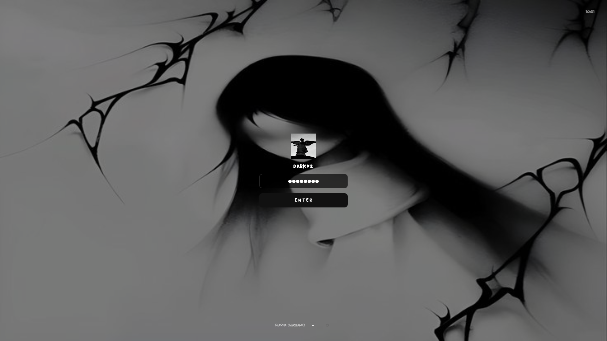

# 🖤 Stealth Dark SDDM v2

An ultra-clean, minimal, and modern dark theme for **SDDM** (Simple Desktop Display Manager). Built for high performance, sleek aesthetics, and flawless Qt6/Qt5 compatibility.



---

## ✨ Features

- 🖤 **Pure Dark Aesthetic**: Clean, distraction-free UI with subtle glassmorphism.
- 👤 **Auto Profile & Username**: Automatically loads system user and avatar (`~/.face.icon` or `AccountsService`).
- 🖼️ **Easy Custom Wallpaper**: Swap the background image with a single command.
- ⚙️ **Session Selector**: Compatible with KDE Plasma, Cosmic, Hyprland, GNOME, XFCE, Sway, and more.
- ⏻ **Power Management**: Built-in Shutdown, Reboot, and Suspend controls.
- 🛡️ **Zero-Bug Engine**: Single-file QML architecture to prevent Qt6/Qt5 import crashes.

---

## 🚀 Installation

### 💙 Arch Linux / CachyOS / Manjaro / EndeavourOS

1. **Install Dependencies:**
   ```bash
   sudo pacman -S sddm qt6-declarative qt6-svg
   ```

2. **Clone and Install Theme:**
   ```bash
   git clone https://github.com/madebydarkxz/stealth-dark-sddm-v2.git
   sudo cp -r stealth-dark-sddm-v2 /usr/share/sddm/themes/stealth-dark-v2
   ```

---

### 🧡 Ubuntu / Debian / Pop!_OS / Linux Mint

1. **Install Dependencies:**
   ```bash
   sudo apt update
   sudo apt install sddm qml-module-qtquick-controls2 qml-module-qtquick-layouts
   ```

2. **Clone and Install Theme:**
   ```bash
   git clone https://github.com/madebydarkxz/stealth-dark-sddm-v2.git
   sudo cp -r stealth-dark-sddm-v2 /usr/share/sddm/themes/stealth-dark-v2
   ```

---

## ⚙️ Enable the Theme

1. Open or create the SDDM configuration file:
   ```bash
   sudo nano /etc/sddm.conf.d/theme.conf
   ```

2. Paste the following configuration:
   ```ini
   [Theme]
   Current=stealth-dark-v2
   ```

3. Save and exit (`Ctrl+O`, `Enter`, `Ctrl+X`).

---

## 🖼️ How to Change the Wallpaper

To use your own custom wallpaper, copy your image into the theme directory and name it `sfondo.jpg`:

```bash
sudo cp /path/to/your/wallpaper.jpg /usr/share/sddm/themes/stealth-dark-v2/sfondo.jpg
```

---

## 🧪 Preview the Theme

You can test and preview the theme instantly without logging out:

```bash
sddm-greeter-qt6 --test-mode --theme /usr/share/sddm/themes/stealth-dark-v2
```

*(For older Qt5 systems, use `sddm-greeter --test-mode --theme /usr/share/sddm/themes/stealth-dark-v2`)*

---

## 📜 License

Distributed under the **MIT License**.

Created with ❤️ by **[DarkXZ](https://github.com/madebydarkxz)**
